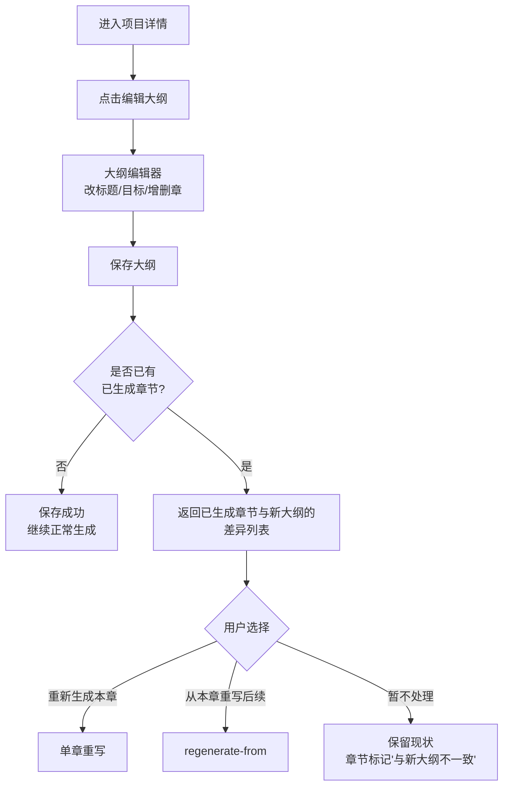
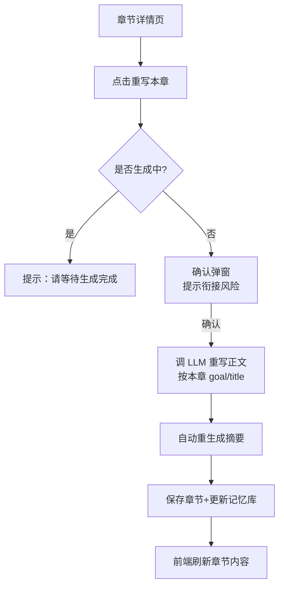

# 需求分析：大纲编辑与章节重新生成

> 版本 v1.0 ｜ 2026-09-11 ｜ 状态：待评审
> 触发场景：用户可能修改大纲，或对生成的某些章节不满意，需要重新生成。

---

## 1. 背景与目标

当前"墨造"平台按「创建即扣费 → 自动生成 → 完成后导出」一次性流程交付小说。实际创作中用户不可能一次满意：

- 大纲生成后，用户想调整剧情走向（改某章目标、增删章节）
- 正文生成后，对某章不满意（文风、情节、长度），想重写
- 修改大纲后，已生成章节与新大纲不一致

**目标**：让用户能对已创建项目进行**大纲编辑**与**章节级重新生成**，且不破坏剧情一致性、不重复扣费（规则待定）、不干扰正在进行的生成任务。

---

## 2. 现状盘点（已基于代码核实）

| 能力 | 现状 | 实现位置 |
|---|---|---|
| 查看大纲 | ✅ 已有（只读） | `GET /api/projects/{id}/outline` |
| 查看章节列表/单章 | ✅ 已有 | `GET /chapters`、`GET /chapters/{no}` |
| 编辑单章（改标题/正文） | ✅ 已有（自动重生成摘要） | `PUT /chapters/{no}` |
| 从某章向后重新生成 | ✅ 已有（删除该章及后续章节+记忆，重跑） | `POST /regenerate-from/{no}` |
| 生成/停止 | ✅ 已有（生成中锁定 409） | `POST /start`、`/stop` |
| **编辑大纲**（改章节 goal/title、增删章） | ❌ **缺失** | 无写接口 |
| **仅重写单章**（保留后续章节） | ❌ 缺失 | 只有"从本章删到末尾"粗粒度 |
| 大纲修改与已生成章节的联动 | ❌ 缺失 | 无变更标记/提示 |
| 前端：大纲编辑 UI / 重写按钮 | ⚠️ 部分（有编辑正文、从某章重生成按钮） | app.js |

**关键机制（影响设计）**：
- 生成是**产物驱动续跑**（`resume()`）：outline.json / world.json / 章节文件存在即复用，删除某章文件即从该章续跑
- 记忆库 = 每章摘要列表 + 设定库（world.json），重生成后需同步清理旧摘要
- 章节编辑已支持"正文变更 → 自动重生成摘要"（`edit_chapter`），可复用

---

## 3. 用户场景

**场景 A：调整大纲**
用户看生成的大纲不满意 → 进入大纲编辑 → 修改第 5 章 goal / 插入 1 章 / 删除 1 章 → 保存后选择：重新生成受影响的章节。

**场景 B：重写不满意的单章**
第 8 章生成完，用户觉得文风不对 → 点"重写本章" → AI 按同一目标重新写 → 摘要自动更新。

**场景 C：重写章节并连带后续**
第 6 章关键情节改了，后续章节基于旧剧情 → 点"从第 6 章重写" → 第 6 章及之后全部重生成。

**场景 D：生成中调整**
项目正在逐章生成 → 用户想改大纲 → 需先停止或等待，生成中锁定编辑。

---

## 4. 功能需求（FR）

### FR-1 大纲编辑（新增）
- 编辑范围：章节标题（title）、章节目标（goal）、**插入新章**、**删除章节**、调整章节顺序（可先不做，v2）
- 编辑后保存覆盖 outline.json；**不自动触发重生成**，由用户显式选择后续动作
- 编辑权限：仅项目所有者；生成中禁止编辑（409）

### FR-2 单章重写（新增，细粒度）
- 入口：章节详情页"重写本章"
- 行为：保留本章大纲 goal/title，用 LLM 重新生成正文；自动重生成摘要（复用现有机制）；**后续章节不动**
- 风险提示：重写可能造成与后续章节衔接不一致（记忆库按新摘要更新，后续章内容仍是旧剧情）——UI 需提示，用户可改用 FR-3
- 模式扩展：可选"重写本章 + 后续全部"（即现有 regenerate-from，保留为独立入口）

### FR-3 从某章重新生成（已有，优化）
- 保留现有 `regenerate-from/{no}`：删除该章及之后章节 + 记忆，从该章续跑
- 优化：生成中禁止（已有 409）；确认弹窗明确提示"将删除第 N 章及之后所有已生成内容"

### FR-4 大纲变更联动
- 大纲保存时记录 `outline_modified_at`；若存在已生成章节，返回提示：
  - 该章已生成但 goal/title 已变更 → 标记"与新大纲不一致"
- 前端在章节列表对不一致章节显示提示，提供"重新生成本章 / 从本章重写"操作

### FR-5 一致性保障
- 重写/重生成后记忆库摘要必须同步（删除旧摘要或覆盖新摘要）
- world.json（人物卡/伏笔）不因章节重写而变；若用户改大纲涉及世界观，另行提示重新生成 world（v2 可做）

---

## 5. 流程设计

### 5.1 大纲编辑流程



### 5.2 单章重写流程



### 5.3 状态与并发

- `_RUNS` 运行锁：生成中，大纲编辑 / 重写 / regenerate 全部 409
- 重写本章：单章粒度，短暂锁定该章（防编辑冲突）
- 并发考虑：单用户单项目串行即可（内测规模）

---

## 6. 接口设计（草案）

| 方法 | 路径 | 说明 |
|---|---|---|
| `PUT` | `/api/projects/{id}/outline` | 保存大纲（全量覆盖 chapters） |
| `POST` | `/api/projects/{id}/chapters/{no}/rewrite` | 重写单章（仅本章，正文+摘要） |
| `GET` | `/api/projects/{id}/outline/diff` | 返回大纲与已生成章节的差异（不一致清单） |
| `POST` | `/api/projects/{id}/regenerate-from/{no}` | 已有（保留） |
| `PUT` | `/api/projects/{id}/chapters/{no}` | 已有（编辑正文，保留） |

**Request/Response 草案（outline 保存）**：
```json
PUT /api/projects/{id}/outline
{
  "title": "书名",
  "intro": "简介",
  "chapters": [
    {"no": 1, "title": "章名", "goal": "本章目标"},
    {"no": 2, "title": "章名", "goal": "本章目标"}
  ]
}
// 响应：
{ "saved": true, "changed_chapters": [5, 6], "total_chapters": 40 }
```

---

## 7. 数据与存储变更

| 变更 | 说明 |
|---|---|
| outline.json | 可写（现有结构不变，无 schema 变更） |
| 章节文件 | 重写时覆盖；regenerate 时删除（现有逻辑） |
| memory.json | 重写后覆盖该章摘要；regenerate 时保留 <no 的摘要（现有逻辑） |
| state.json | 重写/重生成后 `last_chapter` 回退到对应章节 |

> 无需数据库表变更（project_owner 已有 price 列用于退费）。

---

## 8. 计费规则（待定，需决策）

当前：创建项目时按目标字数一次性扣费；regenerate-from 不额外扣费。

| 方案 | 说明 | 优点 | 缺点 |
|---|---|---|---|
| **A. 重生成免费**（推荐） | 项目生命周期内，重写/重生成不额外收费 | 用户体验好；鼓励打磨 | 有刷接口成本风险（可加次数限制） |
| B. 按重生成字数收费 | 每次重写按新正文字数 × 单价扣费 | 成本可控 | 体验差，用户可能不敢改 |
| C. 首轮免费+后续收费 | 每章首次重写免费，再改收费 | 平衡 | 规则复杂，易引发投诉 |

**推荐 A + 防滥用**：免费，但限制每个项目每日重生成次数（如 10 次），超出提示联系站长。

---

## 9. 边界与异常

- 大纲为空/越界：保存校验章节号连续性、非空 title/goal
- 删除章节后：大纲重排 `no`；已生成章节若超出新大纲长度 → 多余章节标记"已废弃"或删除（需决策）
- 编辑正文时摘要生成失败：保留旧摘要 + 日志告警（现有行为）
- 扩写模式（mode=expand）与普通模式：大纲编辑逻辑通用
- 长篇分批生成（batch）：大纲编辑后重生成仅影响从修改点起的章节，不重置整书

---

## 10. 待确认决策点（需要你拍板）

| # | 问题 | 推荐 | 为什么需要确认 |
|---|---|---|---|
| 1 | **大纲编辑范围**：只改章节（goal/title/增删）？还是要连书名/简介/世界观一起改？ | 本期只做章节级；书名/简介/世界观编辑放 v2 | 世界观改动会牵动 world.json 重生成，工作量与风险完全不同 |
| 2 | **单章重写是否连带后续**：提供"仅本章"时，后续章节可能剧情衔接不上，是否接受？ | 两个入口都给：仅本章（提示风险）+ 从本章重写后续 | 直接决定接口与 UI 复杂度，也影响内容质量预期 |
| 3 | **计费**：重生成是否额外收费？ | A 免费 + 每日限次 | 商业决策，影响营收与体验 |
| 4 | **删除章节后已生成内容的处理**：大纲删章后，被删章节已生成的正文怎么处理？ | 标记"已废弃"保留文件，用户可自行删除 | 涉及是否保留用户可能想要的内容 |
| 5 | **生成中能否编辑大纲**：| 禁止（需先停止）| 与现有 409 锁一致，避免文件竞态 |

---

## 11. 实施范围（确认后）

- 后端：outline 保存/差异接口 + 单章重写接口（~2 个新端点，复用现有 pipeline）
- 前端：大纲编辑弹层/页面 + 章节操作按钮（重写本章/从本章重写）+ 差异提示
- 测试：接口测试 + 一致性验证（重写后摘要、记忆库正确）
- 交付后：推 devtest → 确认 → 合并 master → 部署
