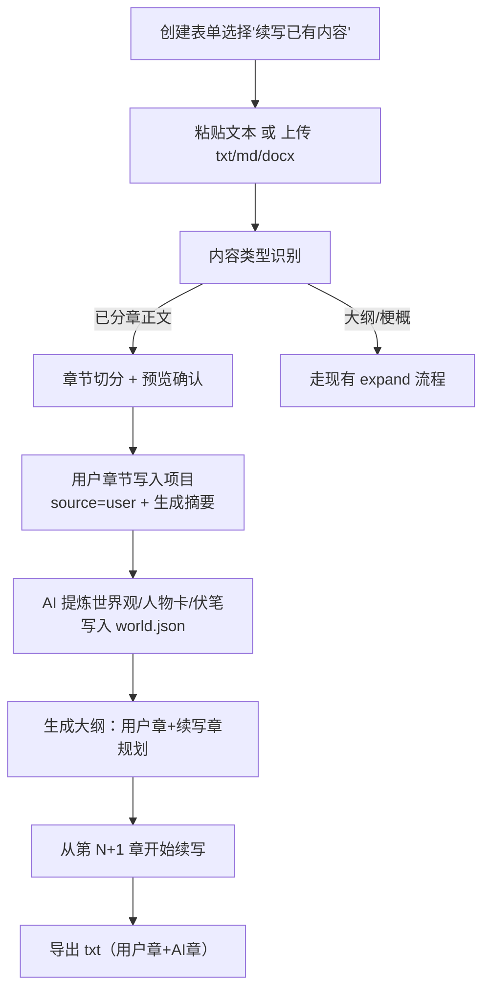
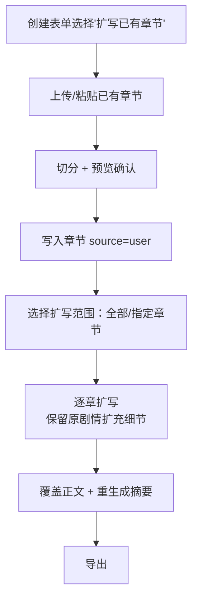

# 需求分析：已有内容续写与扩写

> 版本 v1.0 ｜ 2026-09-11 ｜ 状态：待评审
> 场景：用户已手写一部分小说内容（粘贴或上传文件），需要在本平台继续续写、或对已有章节进行扩写。

---

## 1. 背景与目标

用户带着**已有的手写内容**来到平台，诉求两类：

- **续写**：用户已写前若干章，AI 从断点继续往下写（不重写用户的内容）
- **扩写**：用户已有完整/部分章节，AI 把这些章节写长（加细节、对话、场景），或按用户指定章节扩写

**目标**：用户手写内容必须被**原样保留、纳入项目**，并成为后续生成的人设/世界观/记忆依据；支持**粘贴**与**上传文件**（txt/md/docx）两种输入。

---

## 2. 现状盘点（已核实代码）

| 能力 | 现状 | 说明 |
|---|---|---|
| 扩写模式（mode=expand） | ✅ 已有 | 用户粘贴大纲/梗概 → AI 拆章节大纲 → **从第 1 章开始生成全书** |
| 粘贴入口 | ✅ 已有 | 创建表单 expand 模式 textarea |
| **文件上传 + 文本提取** | ✅ 已有（可复用） | `/api/parse-outline` 支持 txt/md/docx，`outline_parser.extract_text`（utf-8/gbk 回退、docx 解析） |
| **用户正文作为已有章节写入** | ❌ 缺失 | 现有 expand 只把输入当"创意/大纲"，**不保留用户正文**，从第 1 章全量生成 |
| **从断点续写**（跳过用户已写部分） | ❌ 缺失 | 生成永远从第 1 章开始 |
| **基于用户正文提炼人设/世界观** | ❌ 缺失 | world.json 由 AI 凭空生成，可能偏离用户设定 |
| **用户章节的摘要/记忆** | ❌ 缺失 | 续写时 AI 无法衔接用户已写剧情 |
| **正文切分（识别"第N章"）** | ❌ 缺失 | 现有解析面向大纲，不是正文切章 |

**关键机制**：
- 生成是产物驱动续跑：章节文件存在即视为"已写"，从下一章续跑——**只要把用户正文写入章节文件，续写即可天然复用现有 resume 机制**
- memory = 每章摘要列表（`append_summary` 幂等覆盖）
- world.json = 设定库（世界观/人物卡/伏笔），续写前需生成

---

## 3. 用户场景

**场景 A：续写**
用户已手写 3 章（约 8000 字），粘贴或上传 → 平台切分成第 1-3 章写入项目 → AI 提炼人设/世界观/伏笔 → 从第 4 章开始续写到目标字数 → 导出。

**场景 B：扩写**
用户已有 10 章完整正文（每章偏短，约 3000 字/章），目标每章 5000 字 → 平台按章扩写（保留原有剧情与对话，扩充细节/场景/心理）→ 每章字数达标 → 导出。

**场景 C：混合**
用户有 5 章正文 + 后面只写了梗概 → 前 5 章保留，AI 从第 6 章按梗概续写。

**场景 D：中途继续**
用户上次生成到第 8 章，之后自己手写了第 9-10 章，想合并：上传第 9-10 章 → 平台识别"已有章节" → 从第 11 章续写（第 9-10 章保留用户版本）。

---

## 4. 功能需求（FR）

### FR-1 输入方式（新增）
- 创建表单 expand 区新增**上传文件**按钮：txt / md / docx（复用 extract_text，限制 ≤5MB）
- 粘贴与上传互斥或二选一；上传后显示提取预览（前 N 字 + 识别到的章节数）
- 粘贴上限建议 5 万字（超出提示用文件上传）

### FR-2 内容类型识别（新增）
上传/粘贴内容自动（或用户手动选择）归类：
1. **已分章正文**（含"第N章"/章节标题）：切分写入章节文件
2. **大纲/梗概**（无正文）：走现有 expand 流程（从零扩写）
3. **正文+后续梗概混合**：已分章部分切分，梗概部分交给 AI 续写规划

### FR-3 正文切分（新增）
- 规则：按行匹配「第N章」「第 N 章」「章节标题」「一二三四…」等章节标题模式切分
- 未识别出章节标题时：整段作为"用户前置内容"（不切分，作为续写上下文，不写章节文件）
- 切分结果**预览 + 人工确认**（可调整章节边界），避免误切

### FR-4 用户章节入库（新增）
- 用户章节写入 `chapters/{no:03d}.json`，新增 `source: "user"` 标记（AI 生成章 = "ai"）
- **AI 生成流程不覆盖、不重写 user 章节**（单章重写/regenerate 默认跳过 user 章，需用户显式确认才处理）
- 用户章节同样生成摘要进 memory（续写衔接用）

### FR-5 基于用户内容的设定提炼（新增）
- 续写前：新增 prompt「基于用户已有正文提炼世界观/人物卡/伏笔」生成 world.json
- 与现有 world_prompt 的区别：输入是用户正文而非调研报告/创意简介
- 扩写模式：复用/刷新 world.json 后按章扩写

### FR-6 续写（新增）
- 大纲：前 N 章 = 用户章节的标题/goal（从内容提炼）；第 N+1 章起 = AI 按目标字数规划
- 生成从第 N+1 章开始（产物驱动 resume 天然支持）
- 最终导出包含用户章节 + AI 续写章节

### FR-7 扩写（新增）
- 用户选择扩写范围：全部章节 / 指定章节（如 2,5,7）
- 扩写规则：保留原有剧情/对话/人设，只扩充场景细节、动作过程、心理挣扎；不得改变情节走向（复用现有 `_ensure_length` 的扩写原则）
- 扩写后：正文覆盖 + 摘要重新生成（幂等）

### FR-8 与现有功能的兼容
- 大纲编辑（已上线功能）：续写项目同样支持
- 单章重写 / regenerate-from：**默认不触碰 user 章节**，操作 user 章需二次确认
- 退费规则：创建后未生成 AI 章节可退费（user 章节不视为生成产物）

---

## 5. 流程设计

### 5.1 续写流程



### 5.2 扩写流程



---

## 6. 接口设计（草案）

| 方法 | 路径 | 说明 |
|---|---|---|
| `POST` | `/api/projects` | 扩展 ProjectCreateReq：`user_content`（粘贴文本）、`content_type`（`chapters`/`outline`/`mixed`）、`continue_from`（续写起始）、`expand_targets`（扩写章节列表，空=全部） |
| `POST` | `/api/parse-content` | 上传文件 → 提取文本 + 类型识别 + 章节切分预览（复用 parse-outline 的提取逻辑） |
| `POST` | `/api/projects/{id}/split-confirm` | 用户确认切分结果 → 写入 user 章节 + 生成摘要（可在创建接口内完成，视前端交互定） |

**切分预览响应草案**：
```json
POST /api/parse-content  (multipart: file 或 raw text)
{
  "content_type": "chapters",
  "total_chars": 8234,
  "chapters": [
    {"no": 1, "title": "第一章 雨夜", "preview": "前 100 字…", "chars": 3120},
    {"no": 2, "title": "第二章 旧信", "preview": "…", "chars": 2780}
  ],
  "tail": "后续未切分的梗概/内容（若有）"
}
```

---

## 7. 数据与存储变更

| 变更 | 说明 |
|---|---|
| `Chapter` | 新增 `source: str = "ai"`（"user"/"ai"），diff/重写逻辑读取 |
| `config.json` | 新增 `content_type` / `user_content_file`（切分结果引用） |
| world.json | 续写项目由「用户正文提炼」生成（新增 prompt 模板 `world_from_content_prompt`） |
| memory.json | 用户章节也 append_summary（续写衔接） |
| 无数据库表变更 | project_owner 已有 price 列 |

---

## 8. 计费规则（待定，需决策）

现状：创建时按目标字数一次性扣费（每万字 2 元）。

| 方案 | 说明 | 优点 | 缺点 |
|---|---|---|---|
| **A. 按 AI 实际生成字数**（推荐） | 创建时按「目标字数 − 用户已有字数」预估扣费；生成完成多退少补 | 用户不为已有内容付费，公平 | 需实现"生成后按实际字数结算"（退/补差额） |
| B. 按目标总字数 | 与现状一致，最简单 | 实现零成本 | 用户已写部分也收费，续写场景体验差 |
| C. 按档位一口价 | 续写/扩写各一档价 | 简单 | 与"按字数计费"现行体系不一致 |

**推荐 A**：创建时预估扣费（`price_for(目标字数 - 已有字数)`），生成完成导出后按实际 AI 字数结算差额（多退少补，触发余额变动通知）。

---

## 9. 边界与异常

- 上传文件：格式非 txt/md/docx 拒绝；>5MB 拒绝；解析失败（乱码/空文件）提示改用粘贴
- 切分误判：预览确认环节兜底；用户可手动合并/拆分章节边界（v1 提供"合并到上一章"与"整体不切分"即可）
- 续写起点：用户章节 no 需连续；不连续时（场景 D）先重排
- 扩写目标字数：扩写后仍不足时提示用户（不无限扩写）
- AI 生成失败：user 章节永不回退；重试只重生成 AI 章
- 与「大纲编辑/章节重写」（已上线）交互：user 章节默认保护，操作需二次确认

---

## 10. 待确认决策点（需要你拍板）

| # | 问题 | 推荐 | 为什么需要确认 |
|---|---|---|---|
| 1 | **入口形态**：扩展现有 expand 模式（加"续写/扩写"两个子选项 + 上传按钮）？还是新建独立模式？ | 扩展现有 expand 模式，拆成三选一：纯扩写（现状）/ 续写已有内容 / 扩写已有章节 | 影响前端表单结构与模式切换逻辑 |
| 2 | **计费**：续写/扩写按什么收费？ | **A 按 AI 实际生成字数**（创建预估扣费，完成多退少补） | 商业决策；涉及结算逻辑改动（多退少补） |
| 3 | **用户章节保护强度**：单章重写/regenerate-from 是否允许动 user 章节？ | 默认跳过，操作需二次确认（防误覆盖手写内容） | 影响一致性体验与误操作风险 |
| 4 | **切分交互**：切分结果是否要"预览+人工确认"环节？ | 要（识别不准时用户可调整边界），v1 提供"合并/整体不切分"即可 | 决定是否新增 split-confirm 接口与前端步骤 |
| 5 | **续写时是否重新提炼 world**：基于用户正文提炼（推荐）还是沿用现有"从创意生成 world"？ | 基于用户正文提炼（设定一致性最关键） | 决定新增 prompt 模板与生成顺序 |

---

## 11. 实施范围（确认后）

- 后端：`/api/parse-content`（复用 extract_text + 新增章节切分）+ 创建接口扩展（user_content/content_type/continue_from/expand_targets）+ world_from_content 提炼 + 按实际字数结算
- 前端：创建表单 expand 区升级（上传按钮 + 切分预览 + 三选一模式卡片）
- 测试：切分规则用例、续写链路（mock）、扩写链路、user 章节保护、结算差额
- 交付：推 devtest → 确认 → 合并 master → 部署
